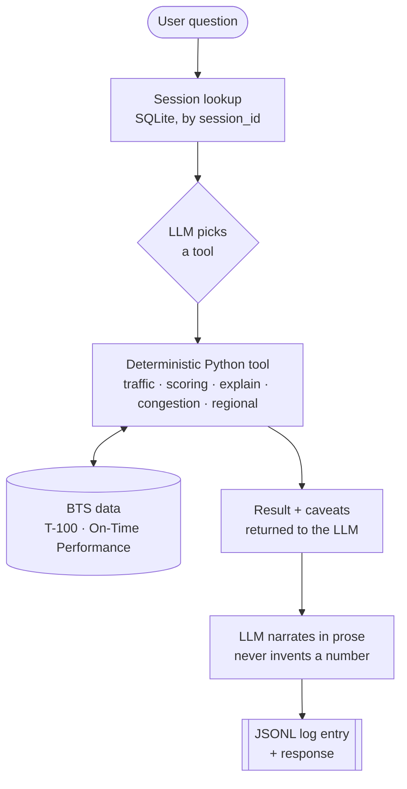
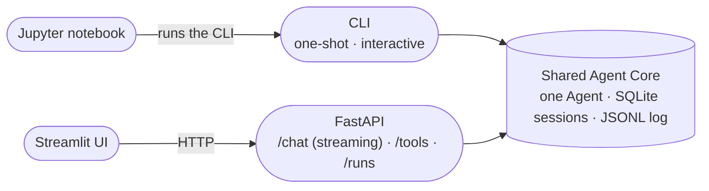

# Airport Investment Intelligence Agent


-2ea44f?style=flat-square)


A lean MVP agent that tells you **which U.S. airports most warrant infrastructure investment** - combining free public flight-traffic data with a transparent, deterministic scoring model.

- Every number is traceable to a real computed value - never an LLM guess
- Every proxy and assumption is disclosed, not hidden behind a confident answer
- All scoring is plain, unit-tested Python - the LLM only routes and narrates

## The one rule everything else follows

> **The LLM never invents a number.**

| The LLM does | The LLM never does |
|---|---|
| Routes a question to the right tool | Performs arithmetic |
| Narrates a tool's already-computed result | Estimates a figure from memory |
| Surfaces every caveat a tool returns | Presents an approximation as fact |

All KPI math, comparisons, and the unmet-demand proxy are deterministic Python, unit-tested independently of the LLM.

## How a request flows



## Front door, one core



One shared `Agent` (`airport_investment_agent/agent.py`), one set of tools, one session store, one run log - the CLI and the API are two thin entry points over the same runtime, and the Streamlit UI is a thin HTTP client of the same API any other caller (`curl`, a script) would use. A conversation started in one front door can be continued from another by reusing its `session_id`.

## Features

| Category | What's included |
|---|---|
| **Interfaces** | FastAPI (`/health` `/chat` `/tools` `/runs`) · Streamlit chat UI (streaming responses, session history) · CLI (one-shot + interactive) · Jupyter notebook demo · Docker/Compose |
| **Analysis** | Single-airport lookups · unmet-demand explanations (single-airport or two-airport comparison) · 2+-airport investment comparisons · pairwise congestion comparisons · region-based ranking (5 curated U.S. regions) · nationwide ranking |
| **KPIs** | Load factor · passengers/departure · YoY growth · completion rate · delayed-departure rate · congestion (DDI) · avg taxi-out time · long-haul share |
| **Trust & memory** | Multi-turn SQLite sessions · structured JSONL run log (usage + latency) · SDK tracing · a live web-search fallback (context only, never scores) |

## Quick start (Docker, recommended)

This is the intended way to run the project - two containers, no local Python setup, no dependency conflicts.

**1. Install Docker.** Get [Docker Desktop](https://www.docker.com/products/docker-desktop/) (includes Docker Compose) for your OS and make sure it's running. Docker itself is required for this path - if you can't or don't want to install it, skip to [Running without Docker](#running-without-docker-secondary) instead.

**2. Configure** - copy `.env.example` to `.env` and fill in your key:
```bash
cp .env.example .env
```
```
OPENAI_API_KEY=sk-...
```
This is the only variable the app reads from the environment. Don't have a key yet? Create one at [platform.openai.com/api-keys](https://platform.openai.com/api-keys).

**3. Run:**
```bash
docker compose up --build
```

`docker-compose.yml` builds and runs two services: the FastAPI backend (`app`, from `Dockerfile`) and the Streamlit UI (`streamlit`, from `Dockerfile.streamlit`).

| Service | Port | URL |
|---|---|---|
| `app` (FastAPI) | 8000 | http://localhost:8000 |
| `streamlit` (UI) | 8501 | http://localhost:8501 |

Once both containers report healthy, open **http://localhost:8501** for the chat UI, or hit the API directly at the URLs above.

- The `app` service reads `OPENAI_API_KEY` from `.env` via `env_file` - `streamlit` doesn't need its own `.env`; it only talks to `app`.
- `streamlit` talks to the API over the internal Docker network at `http://app:8000` (set via the `API_URL` environment variable in `docker-compose.yml`), not `localhost`.
- `streamlit` waits for `app`'s healthcheck to pass before starting (`depends_on: condition: service_healthy`).
- `./airport_investment_agent/data` is mounted into the `app` container so the SQLite session store and JSONL run log persist across restarts.
- Run in the background with `docker compose up --build -d`, and tear down with `docker compose down`.
- To rebuild after changing dependencies or code, run `docker compose up --build` again (Compose only rebuilds images whose Dockerfile or build context changed).

## Running without Docker (secondary)

Use this path if installing Docker isn't an option. It requires a local Python 3.13+ and runs the API and Streamlit UI as separate processes yourself.

**1. Install Python 3.13+**

Check what you have first:
```bash
python3 --version
```
If that's 3.13 or newer, skip ahead to step 2. Otherwise:

| OS | How |
|---|---|
| macOS | `brew install python@3.13` (needs [Homebrew](https://brew.sh)), or download from [python.org](https://www.python.org/downloads/) |
| Windows | Download the installer from [python.org](https://www.python.org/downloads/) - check "Add python.exe to PATH" during install |
| Linux (Debian/Ubuntu) | `sudo apt update && sudo apt install python3.13 python3.13-venv` |

**2. Set up the project**
```bash
git clone https://github.com/ofirgady/airport-agent.git
cd airport-agent
python3 -m venv .venv
source .venv/bin/activate          # Windows: .venv\Scripts\activate
pip install -r requirements.txt    # editable install of the package + dev tools (requirements.txt is just `-e .[dev]`)
```

**3. Configure** - copy `.env.example` to `.env` and fill in your key (see step 2 of the Docker instructions above for where to get one):
```bash
cp .env.example .env
```

**4. Run** - pick an interface:

| Interface | Command |
|---|---|
| API | `uvicorn airport_investment_agent.api:app --reload` |
| Streamlit UI | `streamlit run client/app.py` *(requires the API running)* |
| CLI, one-shot | `python -m airport_investment_agent "Compare JFK, LAX and ORD"` |
| CLI, interactive | `python -m airport_investment_agent` |
| Notebook demo | `jupyter notebook notebooks/demo.ipynb` |

The CLI takes `--session-id <id>` to continue an earlier conversation, e.g. a follow-up like *"what about ORD too?"* resolves against the airports already discussed in that session.

**API, example calls:**
```bash
curl -N -X POST http://localhost:8000/chat \
  -H "Content-Type: application/json" \
  -d '{"session_id": "demo-1", "message": "Explain unmet demand at ORD"}'

curl http://localhost:8000/tools    # introspect registered tools
curl http://localhost:8000/runs     # read the JSONL run log
```

`/chat` streams its answer as Server-Sent Events (`-N` disables curl's own output buffering so you see it arrive incrementally) - it's what the Streamlit UI uses under the hood.

## KPIs

| KPI | What it is | Source |
|---|---|---|
| Utilization / load factor | BTS's own published per-airport average | Real BTS T-100 data |
| Passengers per departure | BTS's own published per-airport average | Real BTS T-100 data |
| Growth rate | Year-over-year passenger change | Real BTS T-100 data, 2 most recent complete years |
| Completion rate | `1 − cancelled / scheduled` flights | Real BTS On-Time Performance data, latest published month |
| Demand-pressure proxy | Blended volume/efficiency/growth signal | **Explicitly a proxy** - no public dataset measures "unmet demand" directly |

Full KPI list, exact formulas, and composite-score math → [Documentation](#documentation).

## Testing

| Command | Runs | Requires |
|---|---|---|
| `pytest` | Full suite, mocked | Nothing - no API key, no network |
| `pytest -m live` | + a handful of real end-to-end tests | A real `OPENAI_API_KEY` |

## Documentation

Full detail behind the KPIs, scoring, and design decisions above, inlined in full below so nothing requires clicking away. Each one also still exists as its own file under [`.doc/`](.doc/) if you'd rather read or link to one topic standalone:

| Doc | Covers | Jump to inline section | Standalone file |
|---|---|---|---|
| Design Notes | Data sources, KPI definitions, assumptions/limitations/proxies | [↓ Design Notes](#design-notes-data-sources-kpis--assumptions) | [`.doc/design.md`](.doc/design.md) |
| Scoring Methodology | The three composite scoring formulas | [↓ Scoring Methodology](#scoring-methodology) | [`.doc/scoring-methodology.md`](.doc/scoring-methodology.md) |
| Key Tradeoffs | Deliberate design choices, and why | [↓ Key Tradeoffs](#key-tradeoffs) | [`.doc/key-tradeoffs.md`](.doc/key-tradeoffs.md) |
| Where/How AI Is Used | Exactly what the LLM does and doesn't do | [↓ Where/How AI Is Used](#wherehow-ai-is-used) | [`.doc/where-how-ai-is-used.md`](.doc/where-how-ai-is-used.md) |

### Design Notes: Data Sources, KPIs & Assumptions

#### Data Sources

| Source | Provides | Why this shape |
|---|---|---|
| **BTS T-100** (`data.bts.gov/resource/r495-tyji.json`, Socrata JSON API, free, no key) | Passengers, departures, seats and BTS's own `total_load_factor`, per airport per month (`reporting_month`) - aggregated server-side (SoQL `$group`) into calendar-year rows | BTS publishes T-100 monthly, so one grouped query returns a whole year per row instead of 12 rows to sum client-side. The in-progress year is labelled year-to-date and never compared against a complete year, so growth is calendar-year-over-calendar-year |
| **BTS On-Time Performance** (`transtats.bts.gov/PREZIP/...zip`, free, no key, large throttled flat file) | Flight-level records for one month - powers completion rate, congestion, taxi-out, and long-haul share | One shared download/parse pass, since fetching this file four times per query would be needlessly slow. Delayed-departure classification uses BTS's own `DepDel15` field rather than re-deriving the threshold |
| **Region membership** | A small hardcoded dict of five curated U.S. regions | No free dataset encodes informal regions like "New England" - verified live against OurAirports and FAA data, both of which resolve only to state/administrative codes. The nationwide ranking reuses this same dict's union (~46 airports) as its peer set |

Every KPI below was checked against BTS's own live field list before deciding whether to compute it ourselves or use a published field directly - `total_load_factor` and `DepDel15` were both found and adopted this way.

#### KPI Definitions

| KPI | Formula | Source |
|---|---|---|
| Load factor | BTS's own monthly `total_load_factor`, seat-mile weighted across the year¹ | T-100 |
| Passengers per departure | Annual passengers ÷ annual departures | T-100 |
| Growth rate | (current year - prior year) / prior year | T-100, 2 most recent complete years |
| Completion rate | 1 - cancelled / scheduled (the industry-standard "completion factor") | On-Time Performance, latest month |
| Delayed-departure rate | % of non-cancelled departures BTS's own `DepDel15` field flags ≥15min late² | On-Time Performance, latest month |
| Departure Delay Index (DDI, 0-100) | `delay_rate_pct·0.6 + severity_pct·0.4`³ | On-Time Performance, latest month |
| Congestion score (0-1) | This airport's DDI, clipped and rescaled against the nationwide 5th-95th percentile DDI band (airports with ≥100 non-cancelled departures) | On-Time Performance, latest month |
| Average taxi-out minutes | Mean `TaxiOut` across non-cancelled departures | On-Time Performance, latest month |
| Long-haul share | % of flights with Distance ≥2300mi⁴ | On-Time Performance, latest month |
| Unmet-demand score (0-1) | Equal-weighted (25/25/25/25) blend of volume, load pressure, growth, congestion | Derived |

¹ Not a flat `passengers/seats` ratio - official load factor is RPM/ASM (revenue passenger-miles ÷ available seat-miles), which only equals a flat ratio for a single nonstop segment. Aggregated across a whole airport-year of mixed-distance routes, the two can genuinely diverge, so BTS's own distance-weighted monthly figure is used, and the months are combined as `Σ(lf × seats × avg stage length) / Σ(seats × avg stage length)` - i.e. weighted by available seat-miles - rather than averaged flat (which would over-weight quiet months).
² DOT's own on-time standard (14 CFR Part 234) - exposed as its own field so DDI can be cross-checked against the official definition.
³ `delay_rate_pct` is the delayed-departure rate above; `severity_pct` is the average delay among those, capped at 60min, as a %. This composite (the weights and the cap) is this project's own proxy, not an industry-standard metric - no FAA/DOT/BTS metric by this name exists; only the ≥15min rate ingredient is DOT's official definition.
⁴ A disclosed, round-number judgment call, not a BTS-defined category. Published airline thresholds for where "long-haul" starts range from ~700mi to 3,000mi depending on carrier; the EU's own short/medium/long-haul boundary sits at roughly 1,180-2,175mi.

See [Scoring Methodology](#scoring-methodology) for how these KPIs combine into the three composite scores.

#### Assumptions, Limitations, Proxies

- **Congestion is a proxy for delay, not physical runway/airspace capacity, and DDI is this project's own formula, not an industry-standard one.** A high score can reflect weather, staffing, or hub connection-bank scheduling rather than genuine throughput saturation. `delayed_departure_rate_pct` is exposed alongside DDI so the DOT-standard portion can be checked independently of the custom blend.
- **Unmet demand is an inferred proxy, not a measurement.** No public data source counts passengers who wanted to fly but couldn't get a seat.
- **Long-haul share reflects one month's schedule**, not an annual average - seasonal route changes aren't captured.
- **On-Time Performance data can go stale between snapshot rebuilds.** `traffic.py` checks the snapshot's age on every lookup and appends a caveat suggesting a rebuild (`scripts/build_otp_snapshots.py`) once it's more than `STALE_DATA_WARNING_MONTHS` old - a disclosed staleness check, not an automatic refresh.
- **Region membership is a fixed, manually curated list**, not an authoritative or exhaustive boundary; the nationwide ranking's peer set (their union) inherits the same limitation.
- **A named U.S. scope outside the five curated regions** (a state, metro area, or informal area) is answered by having the LLM identify a plausible airport list from its own knowledge, then running that list through the same deterministic `compare_airports_tool` scoring. The airport *list* is model-selected and disclosed as such - every number computed from it is still real, tool-computed data.
- **Model choice is a stated assumption, not an unexamined default.** `airport_agent` is pinned to `gpt-5.4-mini` at the SDK's own default reasoning effort (`"none"`), made explicit and live-compared against a bumped `reasoning.effort="low"` on the three behaviors the system prompt most depends on: routing across near-duplicate tools, relaying a tool's own validation-error text instead of self-refusing, and not conflating `growth_score` with `growth_vs_fixed_band`. Both tiers got all three right, so the cheaper/faster default was kept.
- **Tool-routing correctness has no default-run test coverage.** The default `pytest` run (no `OPENAI_API_KEY` required) verifies tool schemas, scoring math, and static agent config, but not whether the LLM actually picks the right tool for a given question - that's only exercised by a handful of `@pytest.mark.live` tests. Closing this without a live call would mean building a scripted fake `Model` test double, judged not worth the effort and the ongoing coupling risk to the SDK's internal response format for a lean MVP. Accepted, disclosed gap rather than an oversight.

### Scoring Methodology

Three distinct formulas exist, each with its own normalization contract:

| Formula | Applies to | Composite | Normalized against |
|---|---|---|---|
| Multi-airport comparison | `compare_airports` | `investment_score = 0.35·volume + 0.25·efficiency + 0.25·growth + 0.15·demand_pressure` | The comparison set's own max (volume/efficiency) or min-max range (growth) |
| Region / nationwide ranking | `rank_airports_by_region`, `rank_airports_nationwide` | `investment_score = 0.20·volume + 0.25·growth + 0.25·ddi + 0.15·taxi_out + 0.15·long_haul` | One peer set - a curated region, or the union of all five (~46 airports) for "nationwide" |
| Single-airport unmet-demand | `estimate_unmet_demand`, `compare_unmet_demand` | Equal-weighted (25/25/25/25) blend of volume, load pressure, growth, congestion | A fixed reference band for growth - no natural comparison set for one airport |

**Notes:**
- `demand_pressure = 0.5·volume + 0.5·efficiency`, feeding into the first formula's `demand_pressure` term.
- Region and nationwide ranking share one engine (`regional._rank_airports`) - only the peer set and a disclosed scope caveat differ.
- `compare_unmet_demand` computes the same score for two named airports atomically (both or neither), not a distinct formula.
- All composite weights are a disclosed judgment call, not derived from data.

Conflating these three contracts is a documented pitfall - see `models/models.py`'s `UnmetDemandScore` docstring for why its `growth_vs_fixed_band` field is deliberately not named `growth_score`, despite measuring a conceptually similar thing to `AirportScore.growth_score`.

### Key Tradeoffs

Each tradeoff below is framed against the quality attribute it actually trades off, not just "what we picked" - the biggest one (session storage) is the one most likely to matter if this project ever needed to run at real scale.

#### The biggest one: session storage

| Decision | Instead of | Quality attributes traded | Why |
|---|---|---|---|
| **SQLite file-based sessions** (`SQLiteSession`, one local `.db` file) | A managed, multi-writer database (Postgres, DynamoDB, etc.) | **Scalability & availability** traded for **operational simplicity & cost** | Zero infrastructure to provision, secure, or pay for - the SDK ships `SQLiteSession` as a first-class primitive, so persistence works out of the box with no external service. The real cost: SQLite is single-writer and file-local. It can't be shared across multiple API processes or machines, has no built-in replication/backup, and concurrent write throughput is limited. Correct for a single-process demo; the first thing that would need replacing before any real multi-instance deployment. |

#### Everything else

| Decision | Instead of | Quality attributes traded | Why |
|---|---|---|---|
| Deterministic scoring over LLM judgment, everywhere feasible | LLM blending qualitative factors into a "holistic" score | **Correctness & auditability** over **flexibility** | Reproducibility and auditability are non-negotiable for an investment-decision tool |
| Fixed, hand-picked composite weights | Data-derived weights | **Transparency** over **statistical optimality** | No public labeled-outcome data exists (which airports got funded, and whether it worked) |
| Calendar-year-over-calendar-year growth | Trailing-12-month growth | **Comparability** over **recency** | Complete calendar years compare like-for-like with no seasonality skew; BTS now publishes T-100 monthly, so trailing-12-month growth is a natural next step |
| Single agent + one narrowly-scoped sub-agent | A multi-agent pipeline (planner/critic/router) | **Latency & reliability** over **architectural flexibility** | Would add coordination latency and non-determinism, with nowhere new for the already-deterministic scoring logic to live |
| `gpt-5.4-mini` at the SDK's default reasoning effort | A higher reasoning-effort tier | **Cost & latency** over **theoretical headroom** | Live-compared on the three behaviors the system prompt depends on most - no correctness difference found |
| No offline/mock data path | Keeping the original mock-first MVP skeleton | **Maintainability** over **offline availability** | Real BTS integration became the only meaningfully-used path; a second, increasingly-stale branch wasn't worth maintaining |
| A detected unsupported number is logged, not retried or blocked | An automatic retry-with-correction fix (built and verified working) | **Simplicity** over **defense-in-depth** | Reverted after the run log showed the guardrail had never actually fired - the added complexity wasn't justified by a zero-occurrence failure mode |
| Tool-routing correctness verified live only | A scripted fake `Model` test double | **Delivery speed** over **test coverage** | More engineering than a lean MVP warrants |
| Off-topic guardrail and comparison-honesty are prompt rules, not tool-enforced | Hard-coding every edge case as deterministic logic | **Delivery speed** over **reliability guarantees** | A probabilistic LLM behavior, same caveat as the web-search disclosure rule - cheap to add, but not a hard guarantee the way a tool-level check would be |
| "Nationwide" ranking reuses the curated regions' union (~46 airports) | Sourcing a separate full U.S. airport list | **Maintainability** over **completeness** | Reuses the already-tested peer-set engine and needs no new data source; disclosed as curated, not exhaustive |
| An uncurated-but-named U.S. scope (state, metro area, informal region) is answered via an LLM-selected airport list | A second hand-curated region list | **Coverage** over **verifiability** | Avoids maintaining a 50-state reference table; the airport list (never any number) is model-selected and disclosed as such |
| BTS's own published fields used directly wherever one exists | Re-deriving the same figures ourselves | **Correctness** over **self-sufficiency** | `total_load_factor` and `DepDel15` were found by checking BTS's live field list; official load factor (RPM/ASM) can genuinely diverge from a self-derived flat ratio |
| DDI kept as this project's own composite | Replacing it with a "real" industry metric | **Transparency** over **borrowed authority** | No FAA/DOT/BTS/industry-standard "Departure Delay Index" exists to adopt; its DOT-standard ingredient is exposed separately so it stays independently checkable |

### Where/How AI Is Used

The LLM's job is routing and narration only - never arithmetic.

| The LLM does | The LLM never does |
|---|---|
| Routes a natural-language question to the correct deterministic tool | Performs the underlying arithmetic itself |
| Narrates that tool's already-computed result | Invents or estimates a number |
| Surfaces every `caveats` entry a tool returns (proxy vs. measured, time period) | Presents an approximation as fact |
| Declines and redirects a question with no airport/aviation/investment connection | Answers an off-topic question from its own general knowledge |
| States plainly which airport(s) couldn't be analyzed when part of a comparison fails | Builds a comparative conclusion ("X is higher than Y") from one real result plus one failure |

The last two rows are prompt-level rules, not tool-enforced - a probabilistic LLM behavior, not a hard guarantee (see [Key Tradeoffs](#key-tradeoffs)). `compare_unmet_demand_tool` closes the second gap structurally for that one case: it fails atomically on either airport rather than letting the LLM improvise a comparison from two independent single-airport calls.

The agent is pinned to `gpt-5.4-mini` (see [Assumptions, Limitations, Proxies](#assumptions-limitations-proxies)) rather than left to the SDK's own default, so this behavior is reproducible rather than dependent on whatever `openai-agents` currently defaults to.

#### Single agent, not a multi-agent pipeline

`airport_agent` is one `Agent` with eight deterministic tools plus one sub-agent (`web_search_fallback`) exposed via `Agent.as_tool()` - not a multi-agent system with separate planner/critic/router agents coordinating with each other.

- **Why not multi-agent:** the actual "intelligence" this problem calls for is the scoring logic, which is already fully deterministic and lives entirely outside the LLM (see [Scoring Methodology](#scoring-methodology)). A multi-agent pipeline would add coordination latency and a second layer of non-determinism (agent-to-agent handoffs), without giving that scoring logic anywhere new to live.
- **The one sub-agent that does exist** (`web_search_fallback`) is scoped narrowly to a single job - live web lookups for airport/aviation questions outside the deterministic tools' coverage - not a second decision-maker with its own scoring authority.
- **Both its own instructions and the main agent's** explicitly forbid it from influencing a stated score or ranking.

## Project structure

| Path | Contains |
|---|---|
| `airport_investment_agent/agent.py` | The shared `Agent`: system prompt, model pin, tool registry |
| `airport_investment_agent/api.py` · `cli.py` | Entry points - FastAPI (streaming SSE) and CLI |
| `airport_investment_agent/voice.py` | Experimental voice turn (speech in -> agent -> speech out) on the same SQLite session |
| `airport_investment_agent/models/` | Pydantic models + exception hierarchy |
| `airport_investment_agent/clients/` | External I/O only - BTS T-100 and On-Time Performance downloads/caching |
| `airport_investment_agent/tools/` | traffic, otp_kpis, scoring, explain, congestion, longhaul, regional, web_search, agent_tools, tool_errors |
| `airport_investment_agent/utils/` | Sessions (SQLite), HTTP retry, logging (JSONL), caveat-merging, number-guardrail |
| `airport_investment_agent/data/` | Committed OTP snapshot + gitignored runtime files |
| `client/app.py` | Streamlit chat UI on top of the FastAPI API |
| `notebooks/demo.ipynb` | Walkthrough of real CLI runs: traffic, comparison, unmet demand, news, session memory |
| `scripts/build_otp_snapshots.py` | Rebuilds the committed On-Time Performance snapshot from BTS |
| `tests/` | pytest suite (mocked by default, `-m live` for real end-to-end runs) |
| `.doc/` | Design documentation (see [Documentation](#documentation)) |
